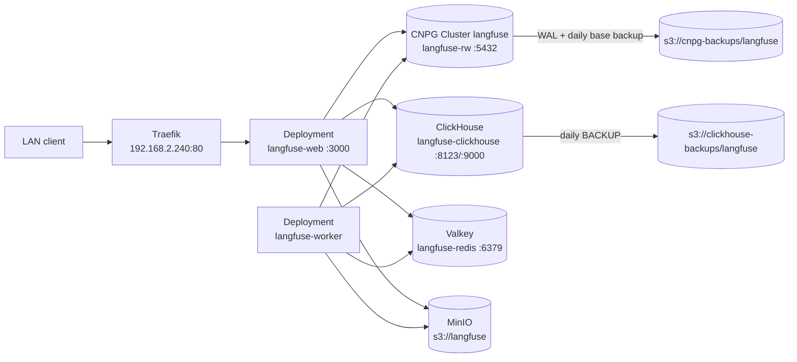

# Langfuse on Talos (LLM observability)

**Status: deployment prepared 2026-10-23; PR pending review, not yet live.**
Langfuse is a self-hosted LLM observability and prompt-management platform. It
runs in the `langfuse` namespace on `talos` and is reachable **LAN-only** at
**`http://langfuse.homelab.home.arpa`**. The host is not under
`*.otakeessen.com`, so the Cloudflare tunnel never routes it.

The app uses the official Langfuse Helm chart (`2.1.6`, app `4.63.0`) with
external stores: CloudNativePG for PostgreSQL, a single-node ClickHouse
StatefulSet, chart-bundled Valkey, and the LAN MinIO for blobs.

## Working setup

| Piece | Value |
|-------|-------|
| LAN entry | `http://langfuse.homelab.home.arpa` -> Traefik VIP `192.168.2.240` -> `langfuse-web:3000` |
| DNS | Pi-hole/local DNS or `/etc/hosts`: `192.168.2.240 langfuse.homelab.home.arpa` |
| Chart | `langfuse` `2.1.6` (app `4.63.0`) from `https://langfuse.github.io/langfuse-k8s` |
| Web image | `docker.langfuse.com/langfuse/langfuse:4.63.0@sha256:67f48d12…` |
| Worker image | `docker.langfuse.com/langfuse/langfuse-worker:4.63.0@sha256:ca32a8fb…` |
| ClickHouse | `StatefulSet/langfuse-clickhouse`, `26.8.28.14`, `50Gi` local-path |
| PostgreSQL | CNPG `Cluster/langfuse` (`langfuse-1`, PG 18.4, `10Gi` local-path) |
| Valkey | chart-bundled `Deployment/langfuse-redis`, `8.0`, `2Gi` local-path |
| Blobs | `s3://langfuse` at MinIO `192.168.2.112:9000` (path-style) |
| Postgres backup | `s3://cnpg-backups/langfuse`, daily 03:00, 30d retention |
| ClickHouse backup | `s3://clickhouse-backups/langfuse/<timestamp>`, daily 04:00, 30d lifecycle |
| Secrets | SOPS `langfuse-secrets` + namespace-local `cnpg-minio` |

## Architecture



Langfuse v4 stores metadata in PostgreSQL, traces/observations/scores in
ClickHouse, queues/cache in Redis, and event/media/batch-export blobs in S3.
The web and worker Deployments share the same configuration and storage.

## Manifest map

All paths are under `infra/clusters/talos/`:

| File | Role |
|------|------|
| `infrastructure/sources/langfuse.yaml` | `HelmRepository` for the Langfuse chart |
| `infrastructure/kustomization.yaml` | lists the new source |
| `apps/langfuse/namespace.yaml` | namespace `langfuse` |
| `apps/langfuse/db-cluster.yaml` | CNPG `Cluster/langfuse` + MinIO backup stanza |
| `apps/langfuse/scheduled-backup.yaml` | daily CNPG `ScheduledBackup` |
| `apps/langfuse/clickhouse-users-configmap.yaml` | templated ClickHouse `users.d` with grants |
| `apps/langfuse/clickhouse-statefulset.yaml` | single-node ClickHouse + initContainer |
| `apps/langfuse/clickhouse-service.yaml` | ClusterIP `langfuse-clickhouse:8123/9000` |
| `apps/langfuse/clickhouse-backup.yaml` | daily native ClickHouse backup CronJob |
| `apps/langfuse/helmrelease.yaml` | Langfuse HelmRelease and all wiring |
| `apps/langfuse/minio-setup.sh` | out-of-band MinIO helper (verify/setup/keys) |
| `apps/langfuse/secret.example.yaml` | secret shape; real Secrets are SOPS/out of band |
| `apps/langfuse/kustomization.yaml` | bundles the app resources |

`apps/kustomization.yaml` lists `langfuse`; Flux reconciles it after
`infrastructure` (so the Helm source and CNPG CRDs exist).

## Why an external ClickHouse

The chart's default `clickhouse.deploy=true` path uses the ClickHouse operator
and `ClickHouseCluster`/`KeeperCluster` CRs, which also require cert-manager.
For this LAN-only, single-instance deployment that is unnecessary weight, so
the chart uses `clickhouse.deploy: false` and an explicit
`langfuse-clickhouse` StatefulSet. No cert-manager or ClickHouse operator is
installed.

`CLICKHOUSE_CLUSTER_ENABLED=false` means plain MergeTree tables, not
ReplicatedMergeTree/Keeper. This is intentionally **not HA**: a node loss takes
the analytics store down.

### ClickHouse users gotcha

The official image's `CLICKHOUSE_USER`/`CLICKHOUSE_PASSWORD` path defines the
user in `users.xml`, which is read-only at runtime. A follow-up SQL `GRANT`
fails with `ACCESS_STORAGE_READONLY`, and `GRANT ALL ... WITH GRANT OPTION`
also fails because the user lacks `NAMED COLLECTION ADMIN`.

The manifests instead render a small `users.d` file in an initContainer from
`clickhouse-users-configmap.yaml`, substituting the password from
`langfuse-secrets`:

```xml
<langfuse>
  <password>__CLICKHOUSE_PASSWORD__</password>
  <networks><ip>::/0</ip></networks>
  <profile>default</profile>
  <quota>default</quota>
  <grants><query>GRANT ALL ON *.*</query></grants>
</langfuse>
```

The endpoint starts with `CLICKHOUSE_SKIP_USER_SETUP=1`, so the entrypoint does
not create the SQL-unmodifiable user. `default` is restricted to localhost so
the entrypoint can still create the `langfuse` database. This was validated
against the real `26.8.28.14` image.

## Secrets and MinIO

Two local SOPS Secrets in namespace `langfuse`:

| Secret | Keys | Used by |
|--------|------|---------|
| `langfuse-secrets` | `username`, `password`, `salt`, `encryption-key`, `nextauth-secret`, `clickhouse-password`, `redis-password`, `default`, `s3-access-key`, `s3-secret-key` | CNPG bootstrap, HelmRelease, ClickHouse, Valkey, S3 |
| `cnpg-minio` | `ACCESS_KEY_ID`, `ACCESS_SECRET_KEY` | CNPG backup stanza |

`default` must equal `redis-password`: Langfuse reads the former key for its
Redis URL while the bundled Valkey sub-chart reads the ACL key named after the
user (`default`).

MinIO layout:

- bucket `langfuse` for event/media/batch-export blobs
- bucket `clickhouse-backups` with prefix `langfuse/`
- policy `langfuse-rw` -> user `langfuse` -> service account
- `cnpg-backups/langfuse/*` added to the existing `cnpg-rw` policy
- `ListBucket`/`GetBucketLocation` are granted on the **whole** bucket;
  prefix-scoping `ListBucket` breaks barman-cloud's `HeadBucket`

Use `apps/langfuse/minio-setup.sh verify` on the NAS to inspect it. Do not
rotate the service account without updating `s3-access-key` /
`s3-secret-key` in `langfuse-secrets`.

## Deployment sequence

1. Create the MinIO buckets/policy/service account (done) and apply the two
   SOPS Secrets out of band:

   ```bash
   bash infra/clusters/talos/apps/secrets/apply.sh
   ```

2. Merge the PR (Flux tracks `main`), then reconcile:

   ```bash
   flux reconcile kustomization infrastructure -n flux-system --with-source
   flux reconcile kustomization apps -n flux-system --with-source
   ```

3. Watch first boot. Postgres/ClickHouse migrations run automatically; the
   `wait-for-deps` initContainer gates web/worker on `langfuse-rw:5432` and
   `langfuse-clickhouse:9000`.

4. Open `http://langfuse.homelab.home.arpa`, create the first admin/org, then
   set `langfuse.features.signUpDisabled: true` in a follow-up PR.

## Verify

```bash
kubectl --context talos -n langfuse get pods,pvc,svc,ingress
kubectl --context talos -n langfuse get cluster langfuse
kubectl --context talos -n langfuse get scheduledbackup
kubectl --context talos -n langfuse get cronjob

kubectl --context talos -n langfuse logs deploy/langfuse-web
kubectl --context talos -n langfuse logs deploy/langfuse-worker

kubectl --context talos -n langfuse exec -it langfuse-clickhouse-0 -- \
  clickhouse-client --user langfuse --password "$CH_PASSWORD" -q \
  'SELECT version(), timezone()'

curl -s http://langfuse.homelab.home.arpa/api/public/health
curl -s http://langfuse.homelab.home.arpa/api/public/ready
```

Expected: CNPG `Cluster in healthy state`, web/worker running, ingress address
`192.168.2.240`, health/ready OK.

## Rollback

1. `flux suspend kustomization apps -n flux-system`.
2. Remove `langfuse` from `apps/kustomization.yaml` and merge.
3. Confirm backups exist under `cnpg-backups/langfuse` and
   `clickhouse-backups/langfuse` before deleting the namespace.

## Notes / risks

- Single-node ClickHouse and single-instance PostgreSQL are **not HA**; a node
  loss takes Langfuse down. Acceptable for LAN observability.
- `local-path` pins ClickHouse/Postgres data to the node holding the PV.
- The 30-day ClickHouse backup retention is enforced by a MinIO lifecycle rule,
  not by the CronJob.
- Images are digest-pinned; bumping Langfuse means updating the chart version
  and both image digests. Do not bump ClickHouse below 25.12 (v4 minimum).
- No TLS on the LAN; `NEXTAUTH_URL` is `http://…`. Add internal TLS later if
  desired.
