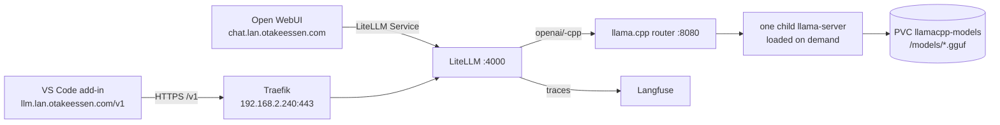

# llama.cpp router on Talos (LAN-only, node-three)

**Status: live and verified 2026-11-03. Ollama was removed on 2026-11-03, so
llama.cpp is now the only CPU inference runtime.** It uses llama.cpp's native
**router mode** so one Deployment serves all four models through LiteLLM.
Open WebUI and a VS Code OpenAI-compatible add-in talk to it through
`llm.lan.otakeessen.com/v1`. In a local A/B test it was about 10% faster than
the Ollama setup it replaced; there is no benchmark automation.

The router loads one model at a time (`--models-max 1`) and unloads the previous
one when a different model is requested. The llama.cpp preset pins a
4096-token context.

## Working setup

| Piece | Value |
|-------|-------|
| llama.cpp API (in cluster) | `http://llamacpp.llamacpp.svc.cluster.local:8080/v1` (OpenAI-compatible) |
| llama.cpp LAN entry | through LiteLLM only: `https://llm.lan.otakeessen.com/v1` |
| LiteLLM key | `sk-litellm` (LAN-only dummy, not a security boundary) |
| Model IDs | `llama3.2-3b-cpp`, `qwen2.5-coder-3b-cpp`, `gemma3-1b-cpp`, `qwen3.5-4b-cpp` |
| Node | `node-three` (`192.168.2.235`), i5-9500 (6 cores / 6 threads), ~24 GB RAM, no GPU |
| Image | `ghcr.io/ggml-org/llama.cpp:server@sha256:10a38e6c…` (build `b12063`) |
| Models | four Q4_K_M GGUFs, ~7.7 GB total, on a 20Gi `local-path` PVC |
| Resources | requests `1 CPU / 4Gi`; limits `4800m` / `9Gi` |
| Runtime flags | `c = 4096`, `t = 6`, `np = 1`, `flash-attn = auto`, `jinja = true` |
| Residency | `--models-max 1`: one llama.cpp model loaded at a time |
| Auth | none on llama.cpp; keep the Service ClusterIP-only |

The llama.cpp preset pins `c = 4096`. Everything stays LAN-only: the Cloudflare
tunnel 404s the whole `lan` sub-zone.

## Architecture



The router process itself is small. It forwards each OpenAI request to a child
`llama-server` for the requested preset, loading it if needed. The child is
stopped when another model is requested. LiteLLM is the only LAN entry point,
so every call is also traced in Langfuse.

## Models and pinned sources

The initContainer downloads these exact files into `/models`; the preset file
references the same names. The IDs use hyphens rather than a colon because
llama.cpp canonicalizes the tag after the last `:` in a preset name (`3b-cpp`
would become `3b-CPP`), which would break the LiteLLM mapping.

| Model ID | Hugging Face repo / commit | File | Size |
|---|---|---|---|
| `llama3.2-3b-cpp` | `bartowski/Llama-3.2-3B-Instruct-GGUF` @ `5ab33fa…` | `Llama-3.2-3B-Instruct-Q4_K_M.gguf` | 2.02 GB |
| `qwen2.5-coder-3b-cpp` | `Qwen/Qwen2.5-Coder-3B-Instruct-GGUF` @ `f74adce…` | `qwen2.5-coder-3b-instruct-q4_k_m.gguf` | 2.10 GB |
| `gemma3-1b-cpp` | `unsloth/gemma-3-1b-it-GGUF` @ `f0b45be…` | `gemma-3-1b-it-Q4_K_M.gguf` | 0.81 GB |
| `qwen3.5-4b-cpp` | `unsloth/Qwen3.5-4B-GGUF` @ `e87f176…` | `Qwen3.5-4B-Q4_K_M.gguf` | 2.74 GB |

Full pinned URLs are in `llamacpp/deployment.yaml`. All four are Q4_K_M GGUF
builds; the exact quant and file are pinned per model.

`qwen3.5` and `gemma3` can take images, but vision needs an `mmproj` file in a
per-model subdirectory. The initial setup is text-only; the text weights and
chat templates are unaffected.

## Manifest map

All paths are under `infra/clusters/talos/apps/llamacpp/`:

| File | Role |
|------|------|
| `namespace.yaml` | namespace `llamacpp` |
| `pvc.yaml` | 20Gi `local-path` GGUF store |
| `configmap.yaml` | `models.ini` router presets (IDs, paths, runtime flags) |
| `deployment.yaml` | pinned Hugging Face downloader + router-mode `llama-server` |
| `service.yaml` | ClusterIP `llamacpp:8080` |
| `kustomization.yaml` | resources |

`apps/kustomization.yaml` lists `llamacpp` so Flux reconciles it after
`infrastructure`. LiteLLM gets four `-cpp` aliases from
`litellm/configmap.yaml`; bump `homelab/litellm-config-version` on the LiteLLM
Deployment when that ConfigMap changes. Likewise, bump
`homelab/llamacpp-preset-version` when `models.ini` changes: the router reads
the file at start and does not watch the mounted ConfigMap. `POST
/models/reload` on the router also re-reads it.

## Use it

### Open WebUI

Start a **new chat** and pick `llama3.2-3b-cpp` (or another `-cpp` model). The
first request to a cold model loads it, so it takes longer than the next one.

### VS Code add-in

Any extension that speaks the OpenAI API (Continue, Cline, Roo Code, …):

```text
Base URL: https://llm.lan.otakeessen.com/v1
API key:  sk-litellm
Model:    llama3.2-3b-cpp   (or qwen2.5-coder-3b-cpp / gemma3-1b-cpp / qwen3.5-4b-cpp)
```

The machine must resolve
`llm.lan.otakeessen.com` to `192.168.2.240` (Pi-hole) and trust the Let's
Encrypt wildcard; use the VPN if you are off-LAN. Set a generous request
timeout for the first cold start.

Notes for coding add-ins:

- `qwen2.5-coder-3b-cpp` and `llama3.2-3b-cpp` support tool calling through
  llama.cpp's Jinja template; `gemma3-1b-cpp` does not.
- The llama.cpp context is 4096. Large editor context can still be truncated;
  keep the add-in's context small on CPU.
- `qwen3.5-4b-cpp` is the strongest of the four but also the slowest on CPU.

### OpenAI-compatible API

```bash
kubectl -n llamacpp run --rm curl -- -s \
  http://llamacpp:8080/v1/models

kubectl -n litellm run --rm curl -- -s \
  http://litellm:4000/v1/chat/completions \
  -H 'Authorization: Bearer sk-litellm' \
  -H 'Content-Type: application/json' \
  -d '{"model":"llama3.2-3b-cpp","messages":[{"role":"user","content":"hi"}],"max_tokens":64}'
```

## Verify

```bash
kubectl -n llamacpp get pod -o wide
kubectl -n llamacpp logs deploy/llamacpp -c download-models
kubectl -n llamacpp logs deploy/llamacpp -c llama-server

# The router lists all four preset IDs.
kubectl -n llamacpp run --rm curl -- -s http://llamacpp:8080/v1/models

# LiteLLM lists the four -cpp models.
kubectl -n litellm run --rm curl -- -s \
  http://litellm:4000/v1/models -H 'Authorization: Bearer sk-litellm'
```

Then send one request per model. The first request for a model should show the
router loading a child instance; the next request to that model is fast. Request
a different model and check that the previous child is stopped.

## Caveats

- It shares `node-three` with the Omarchy VM. The VM has 4 vCPUs but requests
  2 CPU / 6 GiB with a 4-CPU limit; llama.cpp requests 1 CPU / 4 GiB. That fits
  within the node's ~5950m CPU / ~24 GiB, leaving ~455m CPU headroom. CPU is
  shared when both are busy, but they are rarely used at the same time.
- One llama.cpp model is resident at a time. Switching models pays a cold-start
  load; Open WebUI and LiteLLM are unaffected.
- A heavy generation saturates the 6-core node; concurrent generations share
  the CPU limit and both slow down.
- `--models-memory-margin` only helps device memory; host (CPU) memory is
  treated as unlimited. `--models-max 1` is what protects the ~24 GB node.
- The router has no authentication. Keep `llamacpp` ClusterIP-only and never add
  it to `apps/cloudflared/configmap.yaml`.
- `local-path` is node-bound and not backed up. Losing `node-three` means
  re-downloading the GGUFs (the initContainer does this automatically).
- The ~10% speedup over the old Ollama setup was a manual, single-node
  observation, not a controlled benchmark; treat it as indicative.
