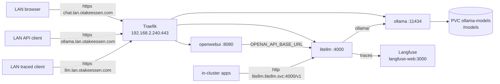
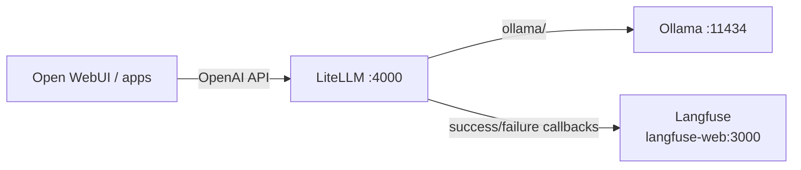

# Ollama + Open WebUI on Talos (LAN-only, node-three)

**Status: Ollama + Open WebUI live since 2026-11-01; LiteLLM/Langfuse tracing in a follow-up PR.**
Ollama is a local LLM runtime pinned to `node-three`, with Open WebUI as a
browser chat UI and LiteLLM as a traced OpenAI-compatible proxy. All are served
**LAN-only** through Traefik on the `192.168.2.240` VIP using the existing
`*.lan.otakeessen.com` wildcard certificate. The Cloudflare tunnel 404s the
whole `lan` sub-zone, so prompts and completions never leave the LAN.

## Working setup

| Piece | Value |
|-------|-------|
| Ollama API (LAN) | `https://ollama.lan.otakeessen.com` -> Traefik -> `ollama.ollama:11434` |
| Ollama API (in cluster) | `http://ollama.ollama.svc.cluster.local:11434` and `/v1` (OpenAI-compatible) |
| Open WebUI | `https://chat.lan.otakeessen.com` -> Traefik -> `openwebui.openwebui:8080` |
| LiteLLM API (LAN) | `https://llm.lan.otakeessen.com` -> Traefik -> `litellm.litellm:4000` |
| LiteLLM API (in cluster) | `http://litellm.litellm.svc.cluster.local:4000/v1` (OpenAI-compatible, traced) |
| Node | `node-three` (`192.168.2.235`), i5-9500 (6 cores / 6 threads), ~12 GB RAM, no GPU |
| Images | `ollama/ollama:0.40.13@sha256:b2f0122c…`, `ghcr.io/open-webui/open-webui:v0.12.5@sha256:03443b8d…`, `ghcr.io/berriai/litellm:v1.106.6@sha256:37e2dafb…` |
| Models | `llama3.2:3b`, `qwen2.5-coder:3b`, `gemma3:1b`, `qwen3.5:4b` (~8–9 GB) |
| Storage | 50Gi `local-path` PVC `ollama/ollama-models` -> `/models`; 5Gi `openwebui-data` |
| Ollama resources | requests `1 CPU / 4Gi`; limits `4800m` (80% of 6 cores) / `9Gi` |
| Open WebUI resources | requests `100m / 256Mi`; limits `1 CPU / 1Gi` |
| LiteLLM resources | requests `100m / 256Mi`; limits `1 CPU / 1Gi` |
| TLS | `traefik/lan-wildcard-tls` served as Traefik's default certificate; no per-app Certificate |
| DNS | Pi-hole resolves `*.lan.otakeessen.com` to `192.168.2.240` |

`node-three` is a control plane with the `NoSchedule` taint removed, which is
why the Ollama pod can run there. `nodeSelector: kubernetes.io/hostname:
node-three` pins it; the `local-path` PV then keeps the model store on that
node.

## Architecture



TLS terminates at Traefik for the LAN hosts. Open WebUI calls LiteLLM over the
ClusterIP Service (server-side, so no CORS and no ingress hop), and LiteLLM
calls Ollama. Apps that want traces use LiteLLM; direct calls to Ollama still
work but are not traced. LiteLLM exports traces to the in-cluster Langfuse
service, so nothing leaves the LAN.

## Manifest map

All paths are under `infra/clusters/talos/apps/`:

| File | Role |
|------|------|
| `ollama/namespace.yaml` | namespace `ollama` |
| `ollama/pvc.yaml` | 50Gi model store |
| `ollama/deployment.yaml` | node-three-pinned Deployment + model-pulling initContainer |
| `ollama/service.yaml` | ClusterIP `ollama:11434` |
| `ollama/ingress.yaml` | `ollama.lan.otakeessen.com` |
| `openwebui/namespace.yaml` | namespace `openwebui` |
| `openwebui/pvc.yaml` | 5Gi state/chat store |
| `openwebui/deployment.yaml` | Open WebUI, pointed at the LiteLLM Service |
| `openwebui/service.yaml` | ClusterIP `openwebui:8080` |
| `openwebui/ingress.yaml` | `chat.lan.otakeessen.com` |
| `litellm/namespace.yaml` | namespace `litellm` |
| `litellm/configmap.yaml` | model aliases + Langfuse callbacks |
| `litellm/deployment.yaml` | stateless LiteLLM proxy, Langfuse env |
| `litellm/service.yaml` | ClusterIP `litellm:4000` |
| `litellm/ingress.yaml` | `llm.lan.otakeessen.com` (LAN API) |
| `litellm/secret.example.yaml` | shape of the out-of-band Langfuse Secret |
| `homepage/helmrelease.yaml` | LAN dashboard tiles for Ollama/Open WebUI |

The `apps` Kustomization lists `ollama`, `openwebui` and `litellm`, so Flux
reconciles them after `infrastructure` (local-path and Traefik already exist).

## Models and how to add more

The model list lives in the `PULL_MODELS` env of
`ollama/deployment.yaml`. On every pod start an initContainer runs a temporary
`ollama serve`, checks `ollama show` for each entry, and pulls only the missing
ones. The check keeps restarts fast and lets the pod boot without internet when
the models are already on the PVC.

- **Quick, one-off:** `kubectl -n ollama exec deploy/ollama -- ollama pull <model>`
  (immediately usable and stored on the PVC).
- **Permanent (survives a fresh PVC):** add the tag to `PULL_MODELS`, commit,
  open a PR, let Flux reconcile. The pod template changes, so the Deployment
  rolls and the new model is pulled.
- **Remove:** `kubectl -n ollama exec deploy/ollama -- ollama rm <model>`, then
  remove it from `PULL_MODELS`. The initContainer only ensures presence; it
  never prunes models.
- **Custom model:** build with a `Modelfile` (`ollama create`). For GitOps, run
  it as a one-off Job against the Service.

Model tags are mutable upstream. To refresh an existing tag, run
`ollama pull <model>` manually (`ollama show` makes the init container skip it).

## API examples

Native API:

```bash
kubectl -n ollama run --rm curl -- -s http://ollama:11434/api/tags

kubectl -n ollama run --rm curl -- -s \
  http://ollama:11434/api/generate \
  -H 'Content-Type: application/json' \
  -d '{"model":"llama3.2:3b","prompt":"Say hi","stream":false}'
```

OpenAI-compatible API (any dummy key):

```bash
curl http://ollama.ollama.svc.cluster.local:11434/v1/chat/completions \
  -H 'Authorization: Bearer ollama' \
  -H 'Content-Type: application/json' \
  -d '{"model":"qwen2.5-coder:3b","messages":[{"role":"user","content":"hi"}]}'
```

Traced, OpenAI-compatible API (through LiteLLM; any bearer token works):

```bash
curl http://litellm.litellm.svc.cluster.local:4000/v1/chat/completions \
  -H 'Authorization: Bearer sk-litellm' \
  -H 'Content-Type: application/json' \
  -d '{"model":"llama3.2:3b","messages":[{"role":"user","content":"hi"}]}'
```

From the LAN:

```bash
curl --resolve ollama.lan.otakeessen.com:443:192.168.2.240 \
  https://ollama.lan.otakeessen.com/api/tags

curl --resolve llm.lan.otakeessen.com:443:192.168.2.240 \
  https://llm.lan.otakeessen.com/v1/models \
  -H 'Authorization: Bearer sk-litellm'
```

Neither API has **authentication**. Keep the ingresses LAN-only and never add
the hosts to `apps/cloudflared/configmap.yaml`. Add a Traefik BasicAuth or IP
allowlist middleware if LAN-wide access is too broad.

## Open WebUI notes

- Open WebUI has the direct Ollama connection disabled
  (`ENABLE_OLLAMA_API=false`) and talks only to LiteLLM, so every chat is
  traceable.
- The first account registered becomes the admin. After creating it, disable
  signups (`ENABLE_SIGNUP=false` in the Deployment) so nobody else can register.
- `WEBUI_SECRET_KEY` is read from the optional `openwebui-secrets` Secret
  (key `webui-secret-key`). Without it, sessions may reset on restart.
  Create it out of band (SOPS or `kubectl`), never in Git.
- The pod is not node-pinned. `local-path` binds its PVC where it first
  schedules and keeps it there.

## Langfuse tracing through LiteLLM

Ollama has no Langfuse export, so **LiteLLM** sits in front of it as a stateless
OpenAI-compatible proxy and exports each call to Langfuse:



- `litellm-config` maps each model name to `ollama/<tag>` at
  `http://ollama.ollama.svc.cluster.local:11434`.
- `success_callback`/`failure_callback: ["langfuse_otel"]` export spans
  (prompt, response, model, tokens, latency) to the in-cluster Langfuse OTLP
  endpoint. The OTel path does not depend on the Langfuse SDK and does not
  break startup when the keys are absent.
- Only calls routed through LiteLLM are traced. Direct `ollama:11434` calls
  bypass Langfuse.

### Create the Langfuse Secret

Generate `pk-lf-…` / `sk-lf-…` in the Langfuse project UI
(`https://langfuse.lan.otakeessen.com` -> project -> Settings -> API keys).
The keys are **local-only**: write them straight into a SOPS file, never into
Git.

```bash
cat > infra/clusters/talos/apps/secrets/litellm-langfuse.sops.yaml <<'EOF'
apiVersion: v1
kind: Secret
metadata:
  name: litellm-langfuse
  namespace: litellm
type: Opaque
stringData:
  langfuse-public-key: "pk-lf-..."
  langfuse-secret-key: "sk-lf-..."
EOF

sops --encrypt --in-place infra/clusters/talos/apps/secrets/litellm-langfuse.sops.yaml
bash infra/clusters/talos/apps/secrets/apply.sh
```

`apply.sh` creates the `litellm` namespace if it does not exist yet. The
Langfuse keys are optional in the Deployment, so the proxy starts even without
the Secret; after creating it, restart to pick it up:

```bash
kubectl -n litellm rollout restart deploy/litellm
```

## Verify

```bash
kubectl -n ollama get pod -o wide                  # Running, on node-three
kubectl -n ollama exec deploy/ollama -- ollama list
kubectl -n ollama logs deploy/ollama -c pull-models
kubectl -n openwebui get pod -o wide
kubectl -n litellm get pod -o wide
kubectl -n litellm logs deploy/litellm | grep -i langfuse
kubectl -n ollama get ingress
kubectl -n openwebui get ingress
kubectl -n litellm get ingress
kubectl -n litellm get secret litellm-langfuse

curl --resolve chat.lan.otakeessen.com:443:192.168.2.240 \
  -I https://chat.lan.otakeessen.com/

kubectl -n litellm run --rm curl -- -s \
  http://litellm:4000/v1/models -H 'Authorization: Bearer sk-litellm'
```

Send one chat through Open WebUI or the LiteLLM curl above, then open
`https://langfuse.lan.otakeessen.com` -> the project -> Tracing: a generation
with the model, tokens and latency should appear within a few seconds.


## Caveats

- CPU-only inference on 6 cores: 3–4B models respond at a few tokens/second.
  Fine for testing and light use, not for heavy concurrency.
- One model is loaded at a time (`OLLAMA_MAX_LOADED_MODELS=1`) and idle models
  unload after 5 minutes (`OLLAMA_KEEP_ALIVE=5m`) to stay inside 12 GB RAM.
- The CPU limit is 80% of the node so the control plane (etcd, kube-apiserver)
  keeps headroom.
- `local-path` is node-bound and not backed up. Losing node-three means
  re-pulling the models (cheap); Open WebUI history is lost unless its PVC is
  backed up separately.
- Tracing depends on LiteLLM being in the request path. Calls sent straight to
  `ollama:11434` or `ollama.lan.otakeessen.com` are not traced.
- Langfuse stores traces in its ClickHouse volume; heavy traffic grows that
  PVC (50Gi).
- `qwen3.5:4b` is multimodal (text + image), which Open WebUI can use.
