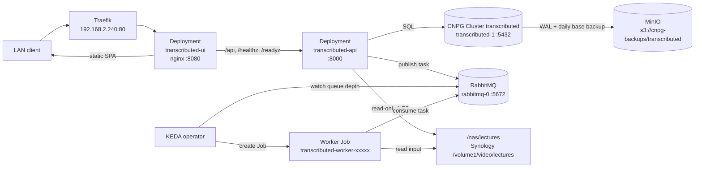
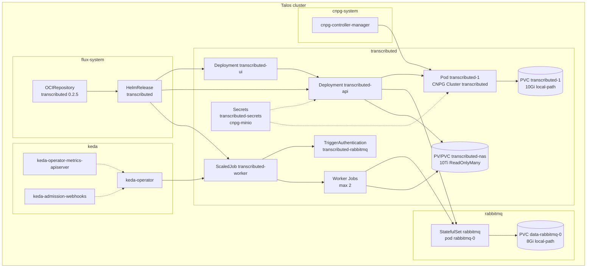

# Transcributed on Talos (architecture)

**Status: live** since 2026-10-20; web UI added 2026-10-21. Transcributed is a
self-hosted lecture transcription app on the `talos` cluster. A Vue UI is served
by nginx, a FastAPI control plane stores projects/runs/tasks in PostgreSQL,
publishes jobs to RabbitMQ, and KEDA creates Faster-Whisper worker Jobs that read
the lecture library from the Synology NAS and write transcripts back to
PostgreSQL.

It is reachable **LAN-only** at
**`http://transcributed.homelab.home.arpa`**. Traefik's `Ingress` routes the host
to the UI; the UI's nginx proxies `/api`, `/healthz` and `/readyz` to the API, so
the browser uses one origin and the API has no separate Ingress. The app has no
authentication yet, so do not route it through the public Cloudflare tunnel.

For the day-to-day runbook, see
[[Running a transcription (Transcributed)]]. The original pre-deployment plan is
kept at [[Transcributed on Talos (deployment plan)]].

## Working setup

| Piece | Value |
|-------|-------|
| LAN entry | `http://transcributed.homelab.home.arpa` -> Traefik `192.168.2.240` -> `transcributed-ui:80` -> `transcributed-api:8000` |
| DNS | Pi-hole record `transcributed.homelab.home.arpa` -> `192.168.2.240` |
| Chart | `oci://ghcr.io/rykhalskyi/charts/transcributed:0.2.5` |
| UI image | `ghcr.io/rykhalskyi/transcributed-ui:v0.2.5` |
| API image | `ghcr.io/rykhalskyi/transcributed-api:v0.2.5` |
| Worker image | `ghcr.io/rykhalskyi/transcributed-worker:v0.2.5` |
| UI workload | `Deployment/transcributed-ui` (1 replica, nginx `:8080`, Service `:80`) |
| API workload | `Deployment/transcributed-api` (1 replica, `:8000`) |
| Worker workload | `ScaledJob/transcributed-worker` (KEDA, 1-2 concurrent Jobs) |
| Broker | `StatefulSet/rabbitmq` (`rabbitmq-0`, `:5672`, management `:15672`) |
| Database | CNPG `Cluster/transcributed` (`transcributed-1`, PostgreSQL 18.4, `:5432`) |
| NAS input | `192.168.2.112:/volume1/video/lectures` -> `/nas/lectures` (**ro**) |
| Backups | `s3://cnpg-backups/transcributed` on MinIO `192.168.2.112:9000`, daily 03:30, 30d retention |
| Secrets | out-of-band SOPS: `transcributed-secrets`, `cnpg-minio`, `rabbitmq-secrets` |

## Request flow



1. Traefik routes the host to the UI Service. The UI nginx serves the built Vue
   assets and proxies `/api`, `/healthz` and `/readyz` to the API Service.
2. The API writes the project, run, and task rows to PostgreSQL.
3. Starting a project publishes one task per included item to the
   `transcription` exchange / `transcription.jobs` queue.
4. KEDA watches the queue; one queued message above `queueLength: 1` creates a
   worker Job (up to `maxReplicaCount: 2`).
5. The worker consumes the task, mounts the NAS read-only at `/nas/lectures`,
   runs `ffmpeg` + Faster-Whisper on CPU, and writes artifacts/status to
   PostgreSQL.
6. The UI polls the API for run/task status and downloads artifacts from
   PostgreSQL.
7. Since `0.2.5`, tasks fail immediately (no automatic retry queues and no
   `max_attempts`); there are no terminal-failure or retry exchanges to drain.
   Cancellation is cooperative (checked every ~30s of audio) and unlocks the
   project for a new run.

## Pods and namespaces



| Namespace | Pods / workloads | Role |
|-----------|------------------|------|
| `transcributed` | `transcributed-ui-*`, `transcributed-api-*`, `transcributed-1`, `transcributed-worker-*` Jobs | UI, API, database instance, on-demand workers |
| `rabbitmq` | `rabbitmq-0` | task queue |
| `keda` | `keda-operator-*`, `keda-operator-metrics-apiserver-*`, `keda-admission-webhooks-*` | queue-driven Job scaling |
| `cnpg-system` | `cnpg-controller-manager-*` | CloudNativePG operator |
| `flux-system` | `OCIRepository/transcributed`, `HelmRelease/transcributed` | GitOps delivery |

The API and worker both mount `transcributed-nas` read-only at `/nas/lectures`.
The NAS PV/PVC is a static NFS volume; it is not backed up by the cluster (the
NAS is the source of truth). Transcript artifacts live in PostgreSQL, so the
CNPG backup covers them.

## Manifest layout

| Path | Role |
|------|------|
| `infra/clusters/talos/infrastructure/sources/keda.yaml` | KEDA HelmRepository |
| `infra/clusters/talos/infrastructure/sources/transcributed.yaml` | OCI chart source, tag `0.2.5` |
| `infra/clusters/talos/infrastructure/keda/` | KEDA namespace and HelmRelease `2.21.0` |
| `infra/clusters/talos/apps/rabbitmq/` | RabbitMQ namespace, headless/ClusterIP Services, StatefulSet |
| `infra/clusters/talos/apps/transcributed/namespace.yaml` | `transcributed` namespace |
| `infra/clusters/talos/apps/transcributed/db-cluster.yaml` | CNPG `Cluster transcributed` |
| `infra/clusters/talos/apps/transcributed/scheduled-backup.yaml` | daily `ScheduledBackup` |
| `infra/clusters/talos/apps/transcributed/helmrelease.yaml` | UI/API/worker chart values, UI Ingress, NAS PV/PVC |
| `infra/clusters/talos/apps/secrets/*.sops.yaml` | local-only SOPS Secrets (not committed) |

Flux applies `infrastructure` before `apps`, so KEDA's `ScaledJob` and
`TriggerAuthentication` CRDs exist before the Transcributed HelmRelease renders
them.

The app repo owns the chart; this repo owns deployment, secrets, the NAS export,
and the supporting operators. That split is recorded as D-16 in the app repo.

## Configuration

The chart renders a ConfigMap consumed by both the API and workers:

| Key | Value | Meaning |
|-----|-------|---------|
| `NAS_INPUT_ROOT` | `/nas/lectures` | root for project item paths |
| `WORKER_BACKEND` | `faster-whisper` | real transcription backend |
| `WHISPER_DEVICE` | `cpu` | no GPU on the Talos nodes |
| `WHISPER_COMPUTE_TYPE` | `int8` | CPU-friendly quantization |
| `WHISPER_MODEL` | `small` | model baked into the worker image |
| `WHISPER_LOCAL_FILES_ONLY` | `true` | never download models at runtime |
| `RABBITMQ_ENABLED` | `true` | API publishes tasks |
| `RABBITMQ_EXCHANGE` | `transcription` | exchange name |
| `RABBITMQ_JOBS_QUEUE` | `transcription.jobs` | queue KEDA watches |

`DATABASE_URL` and `RABBITMQ_URL` come from the `transcributed-secrets` Secret;
the database password also bootstraps the CNPG cluster, so the two values must
match.

### UI and ingress

Chart `0.2.5` adds the UI. The `transcributed-ui` Deployment runs the Vite build
behind `nginxinc/nginx-unprivileged` on `:8080`; its Service listens on `:80`.
nginx serves the SPA with history fallback and proxies `/api/`, `/healthz` and
`/readyz` to `http://transcributed-api:8000`, so the browser only talks to one
origin and the API needs no CORS change.

Only `ui.ingress` is enabled. It uses `ingressClassName: traefik`, so Traefik
serves it on the LAN VIP **`192.168.2.240`** (Cilium LB IPAM, see
`infrastructure/traefik/`). The API Ingress is deliberately disabled: enabling
both on `transcributed.homelab.home.arpa` would create two routers for the same
host and path.

The UI's `/api/*`, `/healthz` and `/readyz` routes are the only API exposure.
`/docs` and `/openapi.json` are not proxied; use a port-forward for those (or a
separate API-only hostname) when regenerating the OpenAPI client.

## Operational notes

- **Image tags.** The published images are tagged `v0.2.5` and `sha-<commit>`,
  but the chart defaults to its `appVersion` (`0.2.5`, without the `v`). The
  HelmRelease pins the UI, API, and worker tags to the `sha-2f6b6f5...` digests;
  the pin workflow in `.github/workflows/update-transcributed-image-pin.yml`
  maintains all three. Do not let the chart fall back to the `0.2.5` tag.
- **Chart 0.2.5.** Adds the UI and removes the invalid `ScaledJob.cooldownPeriod`
  field, so the old HelmRelease `postRenderers` workaround is gone.
- **UI ingress owns the host.** `api.ingress.enabled` is false. If the UI is ever
  disabled, re-enable the API Ingress rather than enabling both.
- **No auth.** Keep the app on the LAN. Do not add a public Cloudflare ingress
  until authentication and multi-user authorization exist.
- **NFS mount options.** The chart default `nfsvers=4.1` is rejected by the
  Synology (`mount.nfs: Protocol not supported`). The HelmRelease sets
  `nas.mountOptions: []` so the client negotiates the version, matching the
  inline NFS mounts used by Navidrome/Nextcloud.
- **NAS export.** `/volume1/video` must be exported to `192.168.2.233` and
  `192.168.2.234` (read-only); the chart mounts the `lectures` subdirectory.
- **MinIO policy.** The `cnpg` user needs
  `arn:aws:s3:::cnpg-backups/transcributed/*` in addition to the existing
  prefixes. Without it, WAL archiving fails with `AccessDenied`.
- **Model limit.** The worker image bakes only the `small` model with
  `WHISPER_LOCAL_FILES_ONLY=true`; requesting another model fails permanently.
- **Concurrency.** KEDA creates one Job per queued task (`queueLength: 1`), up
  to two (`maxReplicaCount: 2`). Each worker requests `1 CPU`/`4Gi` and may
  burst to `4 CPU`/`12Gi`; preferred pod anti-affinity spreads concurrent workers
  across nodes. Jobs run with `activeDeadlineSeconds: 43200` (12h) and are retained
  for 15m after finishing.
- **Backups.** CNPG keeps continuous WAL plus a daily base backup at 03:30 with
  30-day retention. The NAS input is not backed up by the cluster.

## Verify

```bash
flux get kustomizations -n flux-system
flux get helmreleases -n transcributed
kubectl -n transcributed get deploy,svc,ingress,scaledjob,jobs,pvc
kubectl -n rabbitmq get statefulset,pods,pvc

kubectl -n transcributed get cluster transcributed \
  -o jsonpath='{range .status.conditions[*]}{.type}={.status}{"\n"}{end}'
# expect Ready=True and ContinuousArchiving=True

# UI is the LAN entry; it proxies the API health endpoints.
curl -fsS http://transcributed.homelab.home.arpa/ | grep -q '<div id="app">'
curl -fsS http://transcributed.homelab.home.arpa/healthz
curl -fsS http://transcributed.homelab.home.arpa/readyz
curl -fsS http://transcributed.homelab.home.arpa/api/v1/version
```

`/api/v1/version` must return the UI's API version (`0.2.5`). If DNS is not
configured yet, use
`curl --resolve transcributed.homelab.home.arpa:80:192.168.2.240 ...`.

## Upgrading from chart 0.2.1 to 0.2.5

Chart `0.2.5` removes `ScaledJob.cooldownPeriod`; the old HelmRelease's
`postRenderers` remove-patch fails once the field is absent. Because the OCI
source (`infrastructure`) reconciles before the HelmRelease (`apps`), suspend
the release before merging the source bump so the old spec cannot upgrade first:

```bash
flux suspend helmrelease transcributed -n transcributed

# Merge the source tag 0.2.5 + HelmRelease changes, then:
flux reconcile kustomization infrastructure -n flux-system --with-source
flux reconcile kustomization apps -n flux-system --with-source
flux resume helmrelease transcributed -n transcributed
flux get helmreleases -n transcributed
```

The resumed upgrade uses the new spec (no `postRenderers`, UI pinned, UI Ingress
enabled, API Ingress disabled). The `pre-upgrade` hook also drops
`tasks.attempts` and `tasks.max_attempts`; wait for running worker Jobs to
finish first, because the old API/worker (still running until the rollout) query
those columns.

## Common failures

| Symptom | Cause / fix |
|---------|-------------|
| `ImagePullBackOff` on the UI | `ui.image.tag` not pinned; the chart default `0.2.5` does not exist, use `v0.2.5` or the `sha-<commit>@sha256:...` pin |
| `ImagePullBackOff` on API/worker | image tag is `0.2.5` instead of `v0.2.5`; pin both tags |
| `mount.nfs: Protocol not supported` | `nfsvers=4.1`; set `nas.mountOptions: []` |
| Helm upgrade fails with `remove`/`missing path` on `cooldownPeriod` | old `postRenderers` patch with chart 0.2.5; remove it and resume with `--reset` if needed |
| UI loads but API calls 502 | API Service/Deployment not Ready; check `transcributed-api` and `API_UPSTREAM` |
| UI/API route swaps or 404s on the LAN | both `ui.ingress` and `api.ingress` enabled on the same host; disable the API Ingress |
| `ContinuousArchiving=False` / `AccessDenied` | add `cnpg-backups/transcributed/*` to the `cnpg-rw` MinIO policy |
| API `/readyz` returns 503 | database or RabbitMQ unavailable; check the API logs and both workloads |
| No worker Job appears | check `transcription.jobs` queue depth and KEDA logs; a task is only queued after `/start` |
| Task fails permanently with a model error | the image only has `small`; rebuild the worker image for another model |

## Recovering a failed release

The API/worker release can get stuck after a failed install or an immutable PV
change. Suspend/resume is the least disruptive retry:

```bash
flux suspend helmrelease transcributed -n transcributed
flux resume helmrelease transcributed -n transcributed
```

If the release is in `Stalled`/`MissingRollbackTarget`, force one upgrade and
reset the failure count:

```bash
flux reconcile helmrelease transcributed -n transcributed --force --reset
```

A failed release that left an immutable NAS PV/PVC may need those app-only
objects deleted before reinstalling. Do not delete the CNPG PVC
`transcributed-1`; it holds the projects, tasks, and transcripts.

## References

- App chart and values:
  `~/Source/transcributed/charts/transcributed/README.md`
- App build/deploy notes: `~/Source/transcributed/wiki/pages/build-deploy.md`
- [[Running a transcription (Transcributed)]]
- [[Transcributed on Talos (deployment plan)]]
- [[CloudNativePG on Talos (PostgreSQL + MinIO backups)]]
- [[Secrets with SOPS + age (local, out-of-band)]]
- [[Navidrome on Talos (FLAC music server, LAN-only, read-only NAS library)]]
