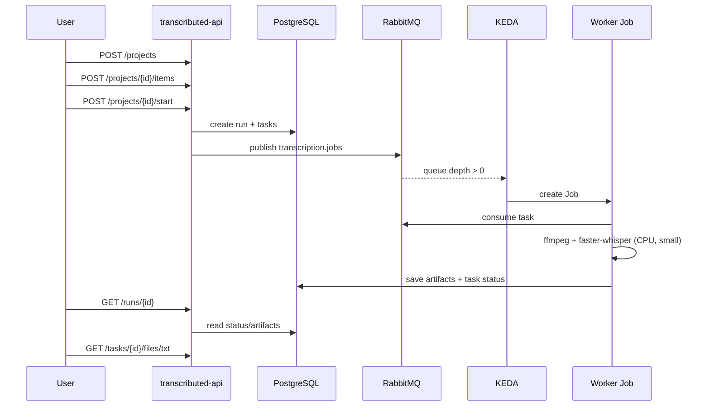

# Running a transcription (Transcributed)

How to send a lecture from the Synology NAS through Transcributed and download
the transcript. Everything runs on the LAN at:

```text
http://transcributed.homelab.home.arpa
```

- Swagger UI: `http://transcributed.homelab.home.arpa/docs`
- OpenAPI: `http://transcributed.homelab.home.arpa/openapi.json`

The API has **no authentication** yet, so it is LAN-only. Do not expose it
through the Cloudflare tunnel. For the cluster architecture, see
[[Transcributed on Talos (architecture)]].

## Before you start

- The file must already be on the NAS under `/volume1/video/lectures`, which is
  mounted read-only at `/nas/lectures`. Add new files through the NAS (SMB or
  File Station); no cluster rescan or Pod restart is needed, because each
  project start resolves the path against the live mount.
- Paths are **relative** to that root and may include subdirectories. Do not use
  a leading `/`, `..`, or backslashes.
- Supported extensions: `.mp4 .mkv .webm .mov .m4v .avi .mp3 .m4a .wav .flac
  .ogg .opus`.
- The deployed worker image bakes **only the `small` model**. Leave `model` at
  `small`; requesting `tiny`, `base`, `medium`, or `large-v3` fails permanently
  because the model is not in the image.
- Only one run can be active per project. Add/edit items before starting.
- A project can hold up to 500 items added per request; each start snapshots the
  current defaults and item overrides.

List the available files through the API Pod, which has the same read-only
mount:

```bash
kubectl -n transcributed exec deploy/transcributed-api -- ls -lah /nas/lectures
```

## Quick start

Set the base URL (and a DNS fallback for a machine that does not use Pi-hole):

```bash
BASE=http://transcributed.homelab.home.arpa
RESOLVE=""
# If the hostname does not resolve:
# RESOLVE="--resolve transcributed.homelab.home.arpa:80:192.168.2.240"
```

Create a project and add one lecture:

```bash
PROJECT=$(curl -sS $RESOLVE -X POST "$BASE/api/v1/projects" \
  -H 'Content-Type: application/json' \
  -d '{
    "name": "Lecture 2",
    "description": "Smoke test / first run",
    "defaults": {
      "language": "ru",
      "model": "small",
      "output_formats": ["txt", "vtt", "json"],
      "max_attempts": 3
    }
  }')
echo "$PROJECT" | jq '{id, name, status, defaults}'
PROJECT_ID=$(echo "$PROJECT" | jq -r .id)

curl -sS $RESOLVE -X POST "$BASE/api/v1/projects/$PROJECT_ID/items" \
  -H 'Content-Type: application/json' \
  -d '{"items":[{"path":"ДЗ 2.1 - часть 1.avi"}]}' | jq
```

Start the run:

```bash
START=$(curl -sS $RESOLVE -X POST "$BASE/api/v1/projects/$PROJECT_ID/start")
echo "$START" | jq '{run: .run.id, status: .run.status, enqueued, not_enqueued, task_ids}'
RUN_ID=$(echo "$START" | jq -r .run.id)
```

Poll the run until it reaches a terminal status:

```bash
curl -sS $RESOLVE "$BASE/api/v1/runs/$RUN_ID" \
  | jq '{status, tasks: [.tasks[] | {id, status, attempts, error, artifacts}]}'
```

Download an artifact once its task is `succeeded`:

```bash
TASK_ID=$(curl -sS $RESOLVE "$BASE/api/v1/runs/$RUN_ID" \
  | jq -r '.tasks[0].id')

curl -sS $RESOLVE -OJ "$BASE/api/v1/tasks/$TASK_ID/files/vtt"
curl -sS $RESOLVE -OJ "$BASE/api/v1/tasks/$TASK_ID/files/txt"
curl -sS $RESOLVE -OJ "$BASE/api/v1/tasks/$TASK_ID/files/json"
```

`-OJ` uses the server's `Content-Disposition` filename (`transcript.vtt`,
`transcript.txt`, `transcript.json`). A `metadata` artifact is also available
from `.../files/metadata`.

Clean up the project after the run is finished or cancelled:

```bash
curl -sS $RESOLVE -X DELETE -o /dev/null -w '%{http_code}\n' \
  "$BASE/api/v1/projects/$PROJECT_ID"
```

## Step by step

### 1. Create a project

```bash
curl -sS $RESOLVE -X POST "$BASE/api/v1/projects" \
  -H 'Content-Type: application/json' \
  -d '{"name":"Course X","description":"optional","defaults":{
        "language":"auto",
        "model":"small",
        "output_formats":["txt"],
        "max_attempts":3
      }}'
```

`defaults` is optional; the defaults are `language: auto`, `model: small`,
`output_formats: ["txt"]`, `max_attempts: 3`.

### 2. Add lectures

```bash
curl -sS $RESOLVE -X POST "$BASE/api/v1/projects/$PROJECT_ID/items" \
  -H 'Content-Type: application/json' \
  -d '{"items":[
        {"path":"ДЗ 2.1 - часть 1.avi"},
        {"path":"subdir/lecture-02.mp4","language":"ru"}
      ]}'
```

The response reports `accepted`, `rejected`, and per-item `results`; check
`error` for rejected paths. Items are validated against the NAS root and the
extension allow-list at add time and again at start time.

### 3. Start the run

```bash
START=$(curl -sS $RESOLVE -X POST "$BASE/api/v1/projects/$PROJECT_ID/start")
RUN_ID=$(echo "$START" | jq -r .run.id)
echo "$START" | jq
```

A `202` response means the run was created. `enqueued` counts messages published
to RabbitMQ; `not_enqueued` should be `0` in this deployment. The run starts as
`queued`; the worker moves it to `running`, then to `completed`,
`partially_failed`, or `failed`.

If the API returns `409`, the project already has a queued/running run, has no
included items, or a source file changed since it was added (remove and re-add
that item).

### 4. Watch progress

Run detail includes every task and its artifacts:

```bash
curl -sS $RESOLVE "$BASE/api/v1/runs/$RUN_ID" \
  | jq '{status, tasks: [.tasks[] | {id, status, attempts, error}]}'
```

Single task:

```bash
curl -sS $RESOLVE "$BASE/api/v1/tasks/$TASK_ID" \
  | jq '{status, attempts, error, artifacts}'
```

The KEDA side:

```bash
kubectl -n transcributed get scaledjob,jobs,pods
kubectl -n rabbitmq exec rabbitmq-0 -- rabbitmqctl list_queues name messages
kubectl -n transcributed logs -l app.kubernetes.io/component=worker --tail=100 -f
```

KEDA polls the queue every 10s. A new task normally produces a
`transcributed-worker-*` Job within one polling interval; the first run also
waits for the worker image pull. Workers log progress once per minute. Up to two
Jobs run concurrently.

### 5. Download the transcript

```bash
curl -sS $RESOLVE -OJ "$BASE/api/v1/tasks/$TASK_ID/files/txt"
curl -sS $RESOLVE -OJ "$BASE/api/v1/tasks/$TASK_ID/files/vtt"
curl -sS $RESOLVE -OJ "$BASE/api/v1/tasks/$TASK_ID/files/json"
curl -sS $RESOLVE -OJ "$BASE/api/v1/tasks/$TASK_ID/files/metadata"
```

| Format | What it contains |
|--------|------------------|
| `txt` | plain text, one segment per line |
| `vtt` | WebVTT with start/end timestamps |
| `json` | detected `language`, full `text`, and timed `segments` |
| `metadata` | task/run/model/worker/elapsed-time details |

The artifacts are rows in PostgreSQL, not files on the NAS. They are covered by
the CNPG backup.

### 6. Cancel

Cancel a whole run:

```bash
curl -sS $RESOLVE -X POST "$BASE/api/v1/runs/$RUN_ID/cancel" | jq '{id,status}'
```

Cancel one task:

```bash
curl -sS $RESOLVE -X POST "$BASE/api/v1/tasks/$TASK_ID/cancel" | jq '{id,status}'
```

Cancellation marks queued/processing tasks `cancelled`, discards their output,
and unlocks the project. Workers check the task status every ~30 seconds of
audio, so an active Job may take a short while to exit.

## Managing projects and items

```bash
# List projects
curl -sS $RESOLVE "$BASE/api/v1/projects" | jq

# Project detail and items
curl -sS $RESOLVE "$BASE/api/v1/projects/$PROJECT_ID" | jq
curl -sS $RESOLVE "$BASE/api/v1/projects/$PROJECT_ID/items" | jq
ITEM_ID=$(curl -sS $RESOLVE "$BASE/api/v1/projects/$PROJECT_ID/items" \
  | jq -r '.[0].id')

# Exclude an item from future runs (does not delete the row)
curl -sS $RESOLVE -X PATCH \
  -H 'Content-Type: application/json' \
  -d '{"included":false}' \
  "$BASE/api/v1/projects/$PROJECT_ID/items/$ITEM_ID" | jq

# Remove an item
curl -sS $RESOLVE -X DELETE -o /dev/null -w '%{http_code}\n' \
  "$BASE/api/v1/projects/$PROJECT_ID/items/$ITEM_ID"

# Change defaults for future runs
curl -sS $RESOLVE -X PATCH \
  -H 'Content-Type: application/json' \
  -d '{"defaults":{"language":"ru","model":"small","output_formats":["txt","vtt"],"max_attempts":3}}' \
  "$BASE/api/v1/projects/$PROJECT_ID" | jq
```

Edits to a project or its items are rejected while a run is `queued` or
`running`. A new start creates a fresh run snapshot; previous runs keep their
own spec.

## How a run flows



## Limits and behaviour

- **Model:** `small` only. The worker image has `WHISPER_MODEL=small` and
  `WHISPER_LOCAL_FILES_ONLY=true`.
- **Language:** `auto`, `en`, `ru`, or `de` (default `auto`).
- **Outputs:** `txt`, `vtt`, `json` (default `txt`).
- **Retries:** up to `max_attempts` (1-10, default 3), via the 1m and 10m retry
  queues. Permanent errors (for example an unavailable model) do not retry.
- **Concurrency:** KEDA creates one worker Job per queued task, maximum two at a
  time. More tasks wait in `transcription.jobs`.
- **Runtime:** a Job has a 12-hour deadline (`activeDeadlineSeconds: 43200`) and
  is retained for 15 minutes after it finishes.
- **Resources:** each worker requests `1 CPU`/`2Gi`, with limits of `4 CPU`/`4Gi`.
  Transcription runs on CPU with `int8`; large recordings can take a long time.
- **Input changes:** the NAS file's size and mtime are recorded when the item is
  added. If the file changes, `/start` rejects it as "Source file changed since
  it was added"; remove and re-add the item.

## Troubleshooting

| Symptom | Check |
|---------|-------|
| `422` on add/start | path is absolute, contains `..`/backslashes, uses an unsupported extension, or the file does not exist under `/nas/lectures` |
| `409` on start | active run, no included items, or a source file changed |
| `503` from `/readyz` | PostgreSQL or RabbitMQ unavailable; check the API logs and both workloads |
| Task stays `queued` | `transcription.jobs` depth, KEDA logs, `ScaledJob` status |
| Task fails with a model error | request `small` only; another model requires a new worker image |
| No transcript after `succeeded` | check `artifacts` in the task response and the requested `output_formats` |
| Cancelled Job lingers | worker checks cancellation every ~30s of audio; wait for the Job to exit |
| `AccessDenied` in CNPG logs | MinIO policy missing `cnpg-backups/transcributed/*` (not an API/worker problem) |

## Verify the service

```bash
curl -fsS "$BASE/healthz"
curl -fsS "$BASE/readyz"
curl -sS "$BASE/api/v1/projects" | jq

flux get helmreleases -n transcributed
kubectl -n transcributed get pods,scaledjob,jobs
kubectl -n rabbitmq exec rabbitmq-0 -- rabbitmqctl list_queues name messages
```

## References

- [[Transcributed on Talos (architecture)]]
- [[Transcributed on Talos (deployment plan)]]
- Swagger UI on the LAN: `http://transcributed.homelab.home.arpa/docs`
- App repo: `~/Source/transcributed` (chart, API, worker, behaviour notes)
